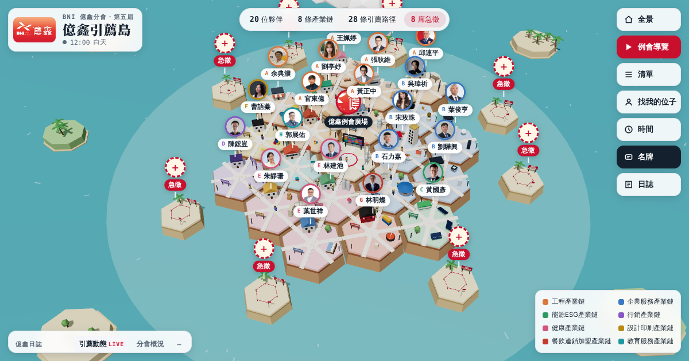

# 億鑫引薦島

BNI 台南市區 **億鑫分會**（第五屆）的 3D 引薦地圖。20 位夥伴各占一座六角島，同一個顏色是同一條產業鏈；島與島之間的小人，是被引薦的客戶。

**線上版：** https://marcuskuo-max.github.io/yixin-referral-island/

## 可以做什麼

| 功能 | 說明 |
|---|---|
| 點一座島 | 看夥伴的「我是／我有／我要」、職務與獎章，以及他送出和收到的引薦路徑 |
| 點路上的小人 | 看這位客戶帶著什麼需求、從誰的島走到誰的島 |
| 例會導覽 | 依週五 06:15–08:15 議程播放一場例會，含 20 位夥伴的 35 秒簡報 |
| 找我的位子 | 來賓選一個急徵席位或輸入自己的產業，看登島後能連到哪些夥伴 |
| 清單 | 依夥伴、產業鏈、引薦路徑、急徵席位搜尋 |
| 時間 | 切換清晨／白天／黃昏／夜晚；週五 06:15–08:15 廣場會連線到每座島 |

## 資料來源

- 億鑫每週例會簡報（目前為 2026/10/30）：八大產業鏈名單、每位夥伴的「我是／我有／我要」、急需要專業別、產業鏈藍圖、領導團隊、本屆願景、累積引薦金額
- 一對一次數與缺席率：BNI 台南市區 2026 年 10 月分會數據統計（9 月數據）
- 夥伴照片：第五屆會員夥伴形象照

引薦路徑中，大部分是依每位夥伴的「我要」配對出來的**引薦建議**，用來準備一對一話題；標示「真實引薦」的，是例會「夥伴引薦分享」上實際發生的案例。

## 更新方式

整站只有一個 `index.html`。資料集中在檔案中段的四個常數：

| 常數 | 內容 |
|---|---|
| `MEMBERS` | 夥伴：姓名、產業鏈、產業、公司、職務、獎章、我是／我有／我要、島的座標與建築樣式 |
| `ROUTES` | 引薦路徑：引薦人、收件人、客戶角色、手上的需求、情境說明 |
| `SEATS` | 急徵席位：產業、所屬產業鏈、登島後連到的夥伴 |
| `AGENDA` | 例會議程（含本週主題簡報與未來六週講者） |

夥伴照片以 base64 內嵌在 `PHOTOS` 常數。改完存檔推上 `main`，GitHub Pages 會自動更新。

## 技術

單一 HTML 檔，[three.js](https://threejs.org/) 0.160（jsDelivr CDN）繪製低多邊形島嶼，介面為原生 HTML／CSS。版面與互動參考〈HEART 政策島〉的六角島嶼設計。

---

億起連結・鑫想事成
